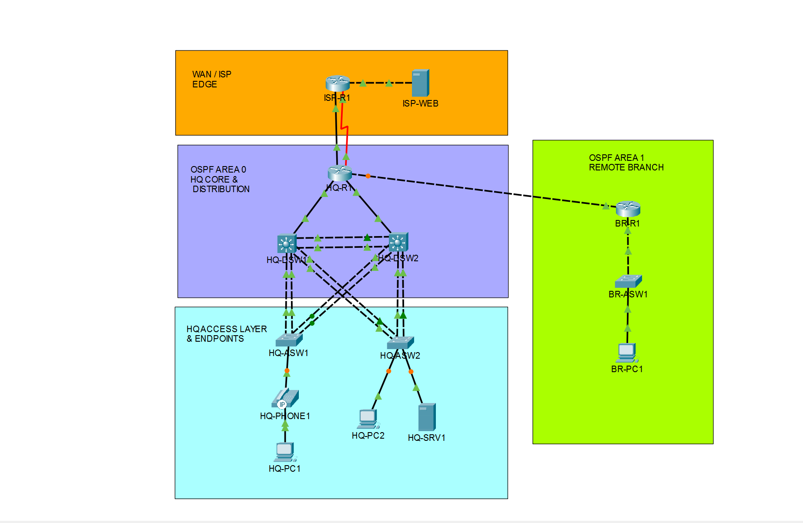

# CCNA 200-301 Enterprise Mega Lab

A complete enterprise network built in **Cisco Packet Tracer** that covers the core technical domains of the **CCNA 200-301** blueprint. It has a redundant HQ campus (collapsed core/distribution), a dual-homed ISP WAN edge and a remote branch office. It comes with a step-by-step workbook that takes you from bare devices to a fully working network.

> Validated end to end on **Packet Tracer 9.0.1**.

---

## What's in this repo

| File | What it is |
|---|---|
| [`labs/MegaLab_Starter.pkt`](labs/MegaLab_Starter.pkt) | Devices placed, modules installed and cabled. **No configuration.** Start here. |
| [`labs/MegaLab_Solution.pkt`](labs/MegaLab_Solution.pkt) | The fully configured lab. Use it to check your work or to compare when something breaks. |
| [`docs/CCNA_200-301_Mega_Lab_Workbook_Rev3.pdf`](docs/CCNA_200-301_Mega_Lab_Workbook_Rev3.pdf) | The workbook: architecture, cabling matrix, addressing plan, 4-phase implementation guide, verification commands, full startup configs and a test checklist. |

## How to use it

1. Install **Cisco Packet Tracer 9.0.1** or newer (free through [Cisco Networking Academy](https://www.netacad.com/)).
2. Open `MegaLab_Starter.pkt`.
3. Follow the workbook **Phase 1 → Phase 4** and run the verification commands at the end of each phase before you move on.
4. Stuck? Open `MegaLab_Solution.pkt` and compare with `show running-config`.

## Topology at a glance

| Tier | Devices | Packet Tracer model |
|---|---|---|
| WAN / ISP edge | ISP-R1, ISP-WEB | ISR 4331, Server-PT |
| HQ WAN edge | HQ-R1 | ISR 4331 (NIM-2T + NIM-ES2-4) |
| HQ core / distribution | HQ-DSW1, HQ-DSW2 | Catalyst 3650-24PS |
| HQ access | HQ-ASW1, HQ-ASW2 | Catalyst 2960-24TT |
| Branch | BR-R1, BR-ASW1 | ISR 2911, Catalyst 2960-24TT |
| Endpoints | HQ-PH1, HQ-PC1, HQ-PC2, HQ-SRV1, BR-PC1 | IP Phone 7960, PC-PT, Server-PT |

## What the lab covers

| CCNA domain | Technologies configured |
|---|---|
| **Layer 2 switching & redundancy** | VLANs (data, voice, server, management, native 999, blackhole 888), 802.1Q trunks with pruning, DTP disabled, LACP EtherChannel (Po1–Po5), Rapid PVST+ root alignment, PortFast, BPDU Guard, HSRPv2 |
| **Layer 3 routing & WAN** | Multi-area OSPFv2 (Area 0 + Area 1), deterministic router IDs, point-to-point and broadcast network types, passive interfaces, cost tuning, router-on-a-stick, primary + floating static default routes (AD 1 / AD 5), default-information originate |
| **IP services** | Centralized server DHCP + local IOS DHCP pool, DHCP relay, voice VLAN with Option 150, static NAT, PAT overload to a public pool (survives WAN failover), NTP master and clients |
| **Security & hardening** | Sticky MAC port security (`restrict` and `shutdown`), extended named inter-VLAN ACLs, standard named VTY ACLs, SSHv2 (2048-bit RSA), unused ports parked in a blackhole VLAN |

## Addressing summary

| Block | Use |
|---|---|
| `10.10.x.0/24` | HQ VLANs (10 Eng, 20 Voice, 30 HR/Sales, 50 Servers, 99 Mgmt) |
| `10.20.x.0/24` | Branch VLANs (110 Data, 199 Mgmt) |
| `172.16.0.0/16` | Point-to-point transit links and OSPF router-ID loopbacks |
| `203.0.113.0/24` | ISP / public side, including the HQ public NAT block `203.0.113.64/29` |
| `198.51.100.0/30` | Serial backup WAN |

The full per-interface plan is in Section 3 of the workbook.

## Default credentials (lab only)

| | |
|---|---|
| Enable secret | `CiscoCCNA#Enable1` |
| SSH username | `admin` |
| SSH password | `CiscoCCNA#Admin1` |

---

## Scope and things you should know

### Topics that are intentionally NOT in this lab

Some CCNA subjects are not configured here. Either they're not that important for this kind of lab, or adding them would make it overcomplicated:

- **IPv6**
- **CDP / LLDP** tuning
- **Root Guard, Loop Guard, BPDU Filter** (BPDU Guard *is* configured on edge ports)
- **Wireless networking**: WLC, lightweight APs, WLANs
- **Network services**: SNMP, Syslog, QoS, FTP, TFTP

Practise them separately, or add them to the lab yourself as an extra challenge.

### Packet Tracer bugs and limitations

Packet Tracer is a simulator, not real IOS, and it has **a lot** of bugs and missing features. Some of them can break this lab:

- **DHCP Snooping and DAI**: with snooping enabled, Packet Tracer 9.0.1 drops relayed DHCP replies over EtherChannels and trunks, even after a reload. Both features were removed from the lab because of this (see the Rev 3 change log in the workbook).
- **Stale DHCP state**: if PCs stop getting leases after many changes, save, fully close Packet Tracer, reopen it and renew.
- **Unsupported commands**: e.g. `ntp source` doesn't exist, and `ip ospf network point-to-point` is ignored on VLAN interfaces.
- **Hardware quirks**: the ISR 4331 has no NIM-2GE, the NIM-ES2-4 ports are Layer 2 only, and 3650 port-channels need `switchport trunk encapsulation dot1q` before `switchport mode trunk`.

If something doesn't work and your config matches the solution, it's probably Packet Tracer and not you. Other versions of Packet Tracer may behave differently.

### Some configurations are questionable

Some design choices in this lab are questionable. That's on purpose, because I'm evil like that. 😈 Spotting what you'd do differently in a real network is part of the exercise.

### How this was made

The lab topology and every device configuration were **100% designed, written and configured by me by hand** in Packet Tracer.

The **workbook PDF was polished with AI**. My original configuration notes were messy and spread all over the place, so I used AI to organize and format them into one clean document. The technical content comes from my own build.

### Why so few end devices?

The lab has only a handful of PCs and phones, one per role or VLAN. Adding more PCs, laptops and so on only adds clutter and lag to the simulation and doesn't teach anything new.

---

## License

Released under the [MIT License](LICENSE). Use it, modify it and share it. Just keep the credit.

---

**Saman Asad**
[LinkedIn](https://www.linkedin.com/in/saman-asad-4187833b8/)
